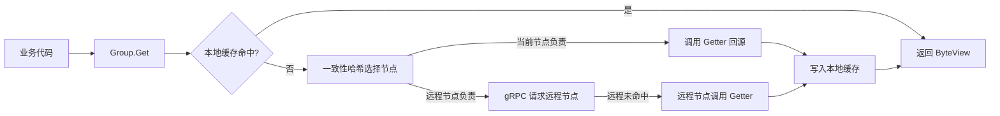

# kamaCache

基于 Go 的分布式内存缓存库。kamaCache 使用 Etcd 做服务发现、gRPC 做节点间通信，并通过一致性哈希将缓存键路由到负责节点；业务代码只需要操作 `Group`，不需要直接处理节点选择和远程调用。

> 当前版本：`v0.2.0`
> 注意：`NewNode` 当前必须连接 Etcd，项目不是完全脱离外部依赖的本地缓存库。

## 特性

- **本地内存缓存**：支持 LRU；内部实现还包含 LRU2（2Q）存储。
- **分布式路由**：通过一致性哈希选择负责节点，节点变化时尽量减少键迁移。
- **服务发现**：节点使用 Etcd 注册和发现，使用相同 `ServiceName` 的节点组成同一缓存集群。
- **gRPC 通信**：跨节点执行 `Get`、`Set`、`Delete`。
- **回源加载**：缓存未命中时调用业务提供的 `Getter`，并将结果写入本地缓存。
- **请求合并**：同一节点上对同一个键的并发加载由 singleflight 合并。
- **多缓存组**：一个节点可以创建多个相互隔离的 `Group`。
- **只读值视图**：`Get` 返回 `ByteView`，避免缓存数据被调用方直接修改。

## 工作方式



`Set` 和 `Delete` 会先操作当前节点，然后在需要时异步转发到负责该键的远程节点。因此跨节点同步是异步的，调用返回不代表所有节点已经完成同步。

## 环境要求

- Go `1.24.4` 或更高版本（以 `go.mod` 为准）。
- Etcd 服务，默认使用 `localhost:2379`。

启动本地 Etcd 的一种方式：

```bash
etcd \
  --listen-client-urls http://127.0.0.1:2379 \
  --advertise-client-urls http://127.0.0.1:2379
```

也可以使用已有 Etcd 实例，但当前服务注册逻辑仍使用默认的 `localhost:2379` 地址；部署到非本机 Etcd 前，请先确认注册逻辑与网络配置一致。

## 安装

```bash
go get github.com/rson9/kamaCache@v0.2.0
```

导入公共包：

```go
import "github.com/rson9/kamaCache/kamacache"
```

## 快速开始

下面的示例启动一个节点，创建名为 `users` 的缓存组，并演示一次回源读取。运行前请先启动 Etcd。

```go
package main

import (
	"context"
	"fmt"
	"log"
	"os"
	"os/signal"
	"syscall"

	"github.com/rson9/kamaCache/kamacache"
)

func main() {
	node, err := kamacache.NewNode(
		// 必须是当前节点监听的地址；多机部署时必须能被其它节点访问。
		kamacache.WithSelfAddr("127.0.0.1:8000"),
		kamacache.WithEtcdEndpoints([]string{"http://127.0.0.1:2379"}),
		kamacache.WithServiceName("demo-cache"),
	)
	if err != nil {
		log.Fatal(err)
	}

	users, err := node.NewGroup(
		"users",
		kamacache.GetterFunc(func(ctx context.Context, key string) ([]byte, error) {
			// 在这里查询数据库或其它后端数据源。
			return []byte(fmt.Sprintf("value-for-%s", key)), nil
		}),
		kamacache.WithMaxBytes(64<<20), // 64 MiB
	)
	if err != nil {
		node.Shutdown()
		log.Fatal(err)
	}

	// Node.Run 会阻塞，通常放到 goroutine 中运行。
	runErr := make(chan error, 1)
	go func() { runErr <- node.Run() }()

	value, err := users.Get(context.Background(), "user:1")
	if err != nil {
		node.Shutdown()
		log.Fatal(err)
	}
	log.Printf("user:1 = %s", value.String())

	stop, stopCancel := signal.NotifyContext(context.Background(), os.Interrupt, syscall.SIGTERM)
	defer stopCancel()
	select {
	case <-stop.Done():
		node.Shutdown()
	case err := <-runErr:
		if err != nil {
			log.Fatal(err)
		}
	}
}
```

保存为 `main.go` 后运行：

```bash
go run .
```

### 多节点部署

在多个进程或多个实例中使用相同的 `ServiceName` 和 Etcd 集群地址，并为每个节点设置不同的 `SelfAddr`：

| 节点 | `SelfAddr` | `ServiceName` |
| --- | --- | --- |
| A | `10.0.0.11:8000` | `production-cache` |
| B | `10.0.0.12:8000` | `production-cache` |
| C | `10.0.0.13:8000` | `production-cache` |

每个节点都需要注册同名的 `Group`。`SelfAddr` 同时用于 gRPC 监听和服务注册；不要在跨主机部署时使用 `localhost` 或 `127.0.0.1`。

## API 速览

### 创建节点

```go
node, err := kamacache.NewNode(
	kamacache.WithSelfAddr("10.0.0.11:8000"),
	kamacache.WithEtcdEndpoints([]string{"http://10.0.0.10:2379"}),
	kamacache.WithServiceName("production-cache"),
)
```

常用节点选项：

| 选项 | 作用 |
| --- | --- |
| `WithSelfAddr` | 设置当前节点监听和注册的地址，必填。 |
| `WithEtcdEndpoints` | 设置服务发现使用的 Etcd 地址，必填。 |
| `WithServiceName` | 设置集群名称；名称相同的节点会互相发现。默认值为 `kamacache`。 |
| `WithLogger` | 设置 Logrus 日志实例。 |
| `WithEtcdLeaseTTL` | 设置节点租约时长的公共配置入口；当前注册实现仍使用固定的 10 秒租约。 |

### 创建缓存组

```go
group, err := node.NewGroup(
	"users",
	getter,
	kamacache.WithMaxBytes(64<<20),
	kamacache.WithCacheType(kamacache.LRU),
)
```

`WithMaxBytes` 对 LRU 缓存尤其重要；建议显式设置为正数。当前公共 API 支持的组配置包括：

- `WithMaxBytes(bytes)`：设置 LRU 最大容量（字节）。
- `WithCacheType(kamacache.LRU)`：使用 LRU 策略。
- `WithCacheType(kamacache.LRU2)`：选择内部 LRU2 实现；其更细粒度的桶容量配置尚未通过公共 API 暴露。
- `WithOnEvicted(fn)`：设置淘汰回调；该回调的参数类型目前引用了 `internal/store`，外部 module 使用时存在 API 暴露限制。

### 读取、写入和删除

```go
ctx := context.Background()

value, err := group.Get(ctx, "user:1")
if err != nil {
	// Getter 或远程节点返回的错误会传到这里。
	return err
}

fmt.Println(value.String())       // 字符串值
bytes := value.ByteSlice()        // 返回数据副本
_ = value.Len()                   // 数据长度

if err := group.Set("user:1", []byte("updated")); err != nil {
	return err
}
if err := group.Delete("user:1"); err != nil {
	return err
}
```

注意：

- `key` 不能为空，否则 `Get`、`Set`、`Delete` 会返回错误。
- `Get` 返回的是 `ByteView`，需要修改数据时请使用 `ByteSlice` 获取副本。
- 当前公共 `Group` API 没有暴露 TTL/过期时间配置。
- `Shutdown` 应在节点退出时调用，以关闭 gRPC、Etcd 客户端和对等节点连接。

## 项目结构

```text
kamacache/                 公共 API：Node、Group、Getter、配置选项
internal/cache/             ByteView 与缓存封装
internal/store/             LRU、LRU2 及底层存储实现
internal/group/             缓存组、回源与请求协调
internal/peer/              一致性哈希、远程 Peer 与节点发现
internal/server/            gRPC 服务端
internal/proto/kama/v1/     Protobuf 定义
example/                    多节点集成测试示例
```

## 开发与测试

运行本地缓存实现的测试：

```bash
go test ./internal/...
```

多节点集成测试依赖本地 Etcd：

```bash
go test ./example
```

## 当前边界

- `NewNode` 当前要求提供 Etcd 地址，尚未提供不依赖服务发现的纯本地 `Node` 模式。
- 节点间的 `Set`/`Delete` 转发是异步的，不能将其当作跨节点强一致写入。
- 当前仓库没有 YAML/TOML 配置加载、Docker/Helm 部署、Dashboard、鉴权等已实现的公共能力；这些内容不应视为当前版本特性。
- 服务注册、租约时长和部分高级缓存参数仍有实现层配置未完全贯通的问题。

## 许可证

[MIT License](LICENSE)
